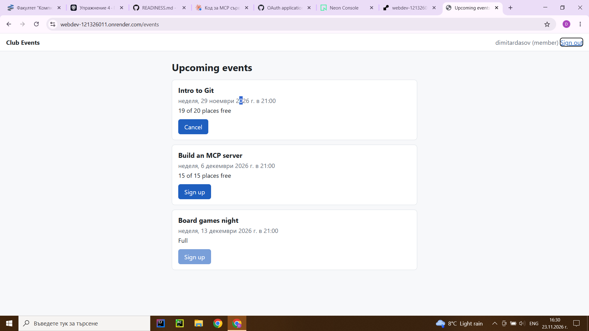
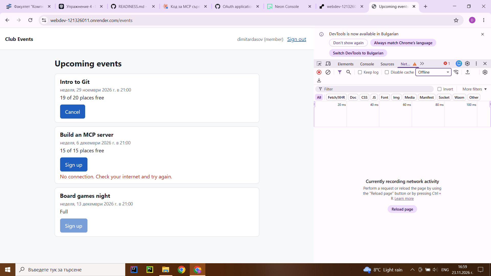

# UI checklist

<!-- Exercise 4 hands this in. Tick an item only when you have checked it, and replace
     the "how I checked" line with what you actually did. An unticked box is not a
     failure: it is a gap you then write into READINESS.md. A ticked box you cannot
     demonstrate at the defence is worse than an unticked one. -->

"Modern" is not a style. It is a short list of things a user notices when they are
missing: the screen tells you what is happening, you can get through it with a keyboard,
the text is readable, and nothing jumps around while it loads.

## Layout and typography

- [x] **One spacing scale and one type scale.** Sizes come from a small set of design tokens, not from numbers typed where they were needed.
        - how I checked: public/style.css has --space-1 … --space-5 and --text-sm … --text-xl on :root and the rules use them instead of typed numbers.
- [x] **Responsive at 380, 768 and 1280 pixels wide.** No horizontal scrollbar, no text running under another element.
    - how I checked: Chrome DevTools device mode on the live /events at 380, 768 and 1280: no horizontal scroll, the cards fit, the name and Sign out stay on one line.
- [x] **Nothing jumps while the page loads.** Images and cards reserve their space before their content arrives.
        - how I checked: the list area reserves its height while "Loading events…" shows; on Slow 4G the cards appear without pushing the page down.

## The four states, on every screen

A screen that only handles "it worked" is a screen that lies to the user on the day it matters.

- [x] **Loading.** Something tells the user the app is working, within about 100 ms.
    - how I checked: "Loading events…" is in the HTML of /events, so it shows with the page; on Slow 4G with cache disabled it stayed under a second before the list.
- [x] **Empty.** The screen says what this list is for and what to do next, instead of showing nothing.
      - how I checked: the empty state now reads "There are no upcoming events yet. Check back soon: organizers add new events here." (public/events.js); not seen live, because the database has upcoming events.
- [x] **Error.** A sentence a person can read. Never a raw JSON body, never a stack trace, never just "Error".
        - how I checked: offline in DevTools on the live site, Sign up shows "No connection. Check your internet and try again." and nothing changes.
- [x] **Success.** The user can see that what they did took effect, without reloading the page to find out.
    - how I checked: on the live site Sign up on "Build an MCP server" changed it to 14 of 15 and the button to Cancel without a reload; Cancel brought back 15 of 15.

## Keyboard and accessibility

- [x] **The main flow works with the keyboard alone.** Sign in, do the core action, sign out, without touching the mouse.
    - how I checked: on the live site with Tab, Shift+Tab and Enter only: Sign in with GitHub, Sign up, Cancel, Sign out.
- [x] **The focused element is visible.** A `:focus-visible` outline that is not switched off.
    - how I checked: while tabbing, a dark outline showed around Email, Password, the Sign in button and the event buttons.
- [x] **Text contrast is at least 4.5:1.** Name the tool you measured with.
    - how I checked: Chrome DevTools inspect tooltip on the live site: the grey date 5.45, the Sign up button 6.09, the Sign out link 6.09, all with a green check.
- [x] **Every input has a label** a screen reader reads, not just placeholder text.
    - how I checked: views/login.html has a visible label for="email" and for="password" above each field.
- [x] **The page has a correct `<title>` and `lang`.**
    - how I checked: both pages have lang="en"; the browser tabs read "Sign in · Club Events" and "Upcoming events · Club Events".
- [x] **Touch targets are at least 44 pixels.**
        - how I checked: DevTools inspect on the live site: Sign up 85.7 × 44, Sign out 75.09 × 44.

## The model feature

- [x] **It shows that it is thinking.** A model call is slow and a free service may have been asleep; a frozen button is the worst possible answer.
        - how I checked: on the live site as an organizer, Suggest details disables the button and shows "Asking the model…" and "This can take a few seconds." while the request runs.
- [x] **It shows when it failed,** and the rest of the screen still works.
       - how I checked: on the live site the provider answered 404 (old model name), 400 (thinkingConfig) and 503 (overloaded); each time the page showed "Suggestions are unavailable, fill in the form yourself" and I still created the event by hand. The reason is in Render's log ("model suggestion fell back: …").
- [x] **The user can tell the model's suggestion from a fact.** It is labelled as a suggestion, not presented as data the app knows.
        - how I checked: fields filled from a model answer get the label "Suggested by the model, check before saving" and nothing is saved until Create event (test in test/events.ui.test.js). Not seen live: Gemini answered 503 during my checks.

## Decisions

- [x] **Dark mode, or a written decision not to have one.**
    - what I decided and why: no dark mode in this version. The app has two light screens and the gaps above (touch targets, error texts, missing screens) matter more to users than a second theme.

## Evidence

- Loading, content and error on /events were checked live with DevTools (Slow 4G and Offline); screenshots in docs/ui/.
- The empty state and the model feature have no live screenshot: the database has upcoming events, and the model feature has no screen yet.